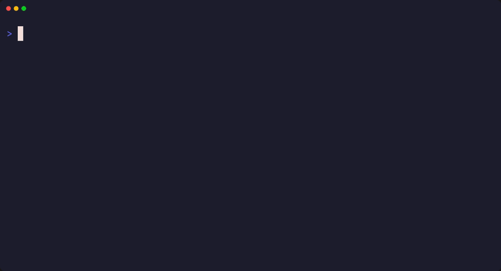
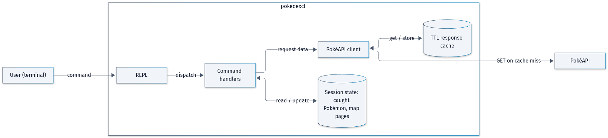

# Pokedex CLI

An interactive command-line Pokedex built in Go and powered by [PokéAPI](https://pokeapi.co/). Explore location areas, catch Pokémon, and inspect your collection from a lightweight REPL.



## Features

- Interactive REPL with case-insensitive command parsing
- Browse paginated location areas and explore the Pokémon found in each one
- Catch Pokémon with a success chance based on base experience
- Inspect caught Pokémon and list your Pokédex with stat-based coloring
- In-memory session state for caught Pokémon and map pagination
- Thread-safe, TTL-based in-memory cache for PokéAPI responses

## Tech Stack

Go · PokéAPI · in-memory TTL cache

## Commands

| Command | Description |
| --- | --- |
| `help` | Show the available commands |
| `map` | List the next 20 location areas |
| `mapb` | List the previous 20 location areas |
| `explore <location-area>` | List the Pokémon found in a location area |
| `catch <pokemon>` | Attempt to catch a Pokémon |
| `inspect <pokemon>` | Show details for a Pokémon you've caught |
| `pokedex` | List every Pokémon you've caught |
| `exit` | Close the Pokedex |

## How It Works



1. `repl.go` reads input, normalizes it, and dispatches commands registered in `commands.go`.
2. Handlers use in-memory session state for caught Pokémon and map pagination; state resets when the program exits.
3. `internal/pokeapi` fetches location and Pokémon data from PokéAPI, with responses cached in `internal/pokecache` to avoid repeat requests.
4. `catch` determines success from a Pokémon’s base experience — weaker Pokémon are easier to catch than stronger ones.

## Run locally

Requires [Go](https://go.dev/dl/) 1.27.3 or newer.

```bash
git clone https://github.com/3mmarx/Pokedex.git
cd Pokedex
go run .
```
